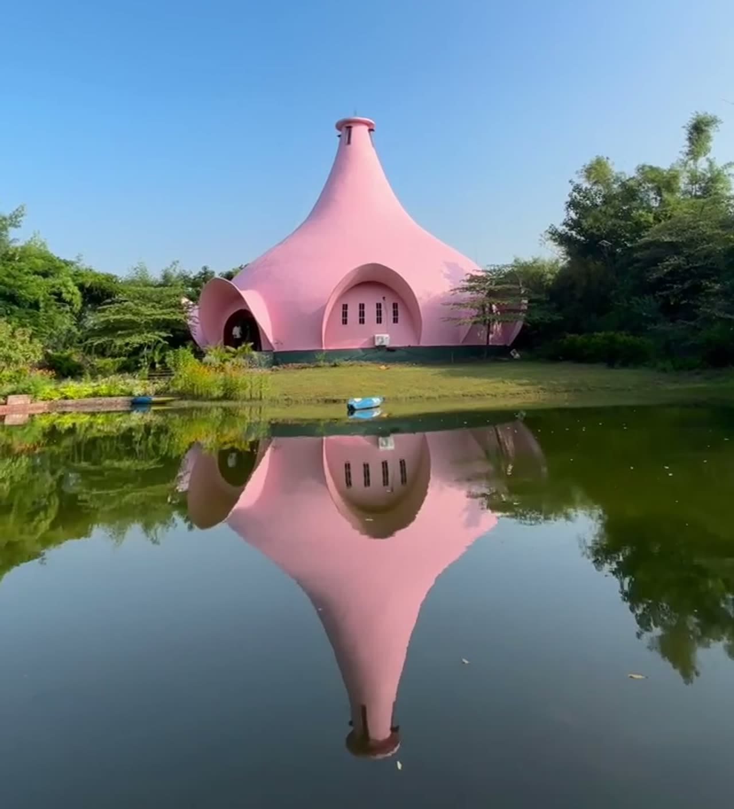

# प्रेरणा तीर्थ · Prerna Tirth

## Inspire. Connect. Transform.

A journey towards nature, human connection, reflection, and joy.

> छान छान मी क्षणोक्षणी प्रत्येक क्षणी 🌿
> *"Beautiful am I, in every moment, at every second." — working translation, to be confirmed.*

Prerna Tirth is an open, community-driven initiative bringing people together
through nature, shared experiences, reflection, learning, and human connection —
associated with Maitri Hills near Kadus–Rajgurunagar, Pune district.
See [`VALUES.md`](VALUES.md) for the full working philosophy.

## The philosophy

| | | |
|---|---|---|
| **Inspire** · प्रेरणा | **Connect** · जोडणे | **Transform** · परिवर्तन |
| Find a spark to begin — nature, reflection, new perspectives. | Reconnect with people and place — shared meals, conversation, learning. | Carry reflection into everyday life — an invitation, never a guaranteed outcome. |

Prerna Tirth is the philosophy, the community, and the shared experience —
the *why*. Maitri Hills is the physical setting — the *where*. The exact
operational relationship is pending stakeholder confirmation.

## The visual story

*Illustrative still from project reel footage — pending approved photography
and consent review. Images showing identifiable people are excluded here until
publication permission is confirmed.*

Stories from the community live on Instagram (handle pending official
confirmation):

- [‘सोच’ youth camp at Maitri Hills](https://www.instagram.com/preranatirth/reel/DKRMLNKTLj8/) — learning and thoughtful discussion
- [Care is never wasted](https://www.instagram.com/preranatirth/reel/DbnT1ZlzJuh/) — kindness and human connection

[Explore Instagram →](https://www.instagram.com/preranatirth/)

*Reel links are verified against project source material. Thumbnail cards are
withheld until approved thumbnails and image consent are confirmed — no
placeholder or stock imagery is presented as authentic footage.*

## Project status

Prototype website live as a static single page. All copy and imagery are
**provisional** pending stakeholder review — see
[`docs/migration/STAKEHOLDER_REVIEW.md`](docs/migration/STAKEHOLDER_REVIEW.md)
for the open questions. No accounts, forms, booking, or data collection.

<strong>Run it (technical setup)</strong>

Prerequisites: Node.js 20+ LTS, npm.

- `npm install` — install dependencies
- `npm run dev` — local development
- `npm run lint` · `npm run typecheck` — quality gates
- `npm run build` · `npm run start` — production build + serve

No environment variables required (`.env.example` holds placeholders only;
`.env.local` is gitignored). The build needs no credentials or database.

<strong>Architecture, design system, and documentation</strong>

- Static-first single route (`/`), Next.js 15 App Router, strict TypeScript,
  Tailwind CSS v4. No Supabase, API, auth, or forms — deferred until a feature
  passes all eight `docs/migration/SUPABASE_SETUP.md` §1 gates.
- Canonical references: [`ARCHITECTURE.md`](ARCHITECTURE.md) (system),
  [`DESIGN.md`](DESIGN.md) (visual system), [`VALUES.md`](VALUES.md) (philosophy).
- Supporting docs: [`docs/product/`](docs/product/) (scope, routes),
  [`docs/engineering/`](docs/engineering/) (security, testing),
  [`docs/decisions/`](docs/decisions/) (architecture records),
  [`docs/migration/`](docs/migration/) (audits, reports).
- `Prerna-Van/` is the frozen prototype reference — do not modify.
- Contributor rules: provisional labels stay; no invented events, prices,
  partnerships, testimonials, or claims (`VALUES.md` §10–§11); small diffs;
  `ponytail:` comments for deliberate simplifications; conventional-commit
  prefixes; one authoritative home per topic — link, don't duplicate.

